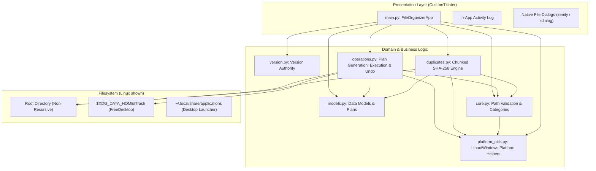

# File Suite


-FCC624?style=for-the-badge&logo=linux&logoColor=black)


A small, serious, carefully engineered desktop utility for organizing loose files and finding byte-identical duplicates inside a selected directory. Linux is the primary platform; Windows support is experimental (see [Windows (experimental)](#windows-experimental)).

File Suite is designed around defensive filesystem practices: **preview before mutation, explicit user confirmation, and deterministic collision safety**. It operates locally on loose files within the chosen target folder without descending into nested subdirectories or modifying hidden files.

<p align="center">
  
  <br/>
  
  <br/>
  
</p>

---

## Features

- **Dry-Run Preview Workflow**:
  Inspect proposed moves before touching disk. The preview displays affected file counts, total size in MB, destination subfolders, and flags any collision renames in advance.
- **Session-Based Undo**:
  Single-level, in-memory undo restoring organized or isolated files back to their original root locations in reverse execution order. Collision detection prevents overwriting files that may have been created at the root after the move.
- **Deterministic Duplicate Manager**:
  - Stable, case-insensitive lexicographic sorting guarantees that the default "original" preserved copy is identical regardless of filesystem directory iteration order.
  - Group-by-group card view displaying SHA-256 digest prefixes and file byte sizes.
  - Clear selection controls ("Select Duplicates" preserves originals, "Clear Selection").
  - Logical reclaimable disk space calculation accounting for shared hard links (avoiding duplicate inode block overcounting).
  - Choice of isolation into a `Duplicates/` folder (undoable) or sending to system trash.
- **Defensive Filesystem Safety**:
  - **Symlink Protection**: Symlinks are strictly skipped to prevent directory traversal or remote target mutation.
  - **Destination Containment Hardening**: Destination paths and intermediate components are re-resolved immediately before execution to reject symlinks injected after the preview phase.
  - **Collision Avoidance**: Multi-part extensions are preserved cleanly (`archive_1.tar.gz`, `data_1.tar.zst`). Existing broken symlinks at destination paths are treated as occupied.
  - **Path Traversal Defense**: User-supplied destination folder names are sanitized against directory traversal attacks (`/`, `\`, `..`, control characters).
  - **Trash Transaction Rollback**: If moving a file to FreeDesktop trash fails, orphaned `.trashinfo` metadata is automatically cleaned up.
- **Responsive Background Scanning**:
  Duplicate scanning runs cooperatively on background threads with chunked 64 KB SHA-256 hashing, pre- and post-hash metadata consistency checks, live progress feedback, and instant cancellation.
- **Diagnostics & Activity Log**:
  In-app viewer and CLI console logging with timestamped records for auditing operational outcomes and debugging fallbacks.
- **Native Desktop Integration**:
  Auto-detects and uses native desktop dialogs (`zenity` on GTK/GNOME, `kdialog` on KDE) with graceful fallback to Tkinter.

---

## Architecture

File Suite maintains strict separation between the presentation layer, domain logic, and filesystem storage:



### Module Responsibilities

| Module | Responsibility |
| :--- | :--- |
| `version.py` | Single source of truth for application versioning. |
| `core.py` | Pure path validation, category mappings, and collision-safe renaming. |
| `models.py` | Typed dataclasses for operation plans, items, execution results, duplicate groups, and scan progress. |
| `operations.py` | Dry-run plan building, TOCTOU containment validation, moves, FreeDesktop trash, and session undo. |
| `duplicates.py` | Size grouping, chunked SHA-256 hashing, deterministic sorting, and cooperative cancellation. |
| `platform_utils.py` | Linux/Windows differences: hidden files, link detection, no-clobber moves, Recycle Bin, folder name rules. |
| `main.py` | Restrained CustomTkinter graphite UI, view router, live progress metrics, and diagnostics. |

---

## Safety Model

File Suite enforces deterministic constraints before and during execution:

1. **Non-Recursive Boundary**: Operations apply exclusively to loose files directly inside the active directory. Subdirectories are never descended into, altered, or deleted.
2. **Pre-Execution Revalidation**: The dry-run preview and execution phases maintain separate trust boundaries. Source file existence, regular file type, and non-symlink status are verified again immediately prior to each move.
3. **Destination Path Containment**: Every target path is checked against the active root directory. If an intermediate directory was replaced by a symbolic link between preview and execution, the operation is aborted for that item.
4. **Collision Avoidance**: Target names that collide with existing files, symlinks or other files in the same batch are suffixed (`file_1.pdf`, `archive_1.tar.gz`) without overwriting existing data.
5. **Path Traversal Defense**: User-supplied folder names cannot escape the root boundary (`/`, `\`, `..`, leading `~`, and control characters are rejected).
6. **FreeDesktop Trash Specification**: Files sent to trash are moved into `$XDG_DATA_HOME/Trash/files` (default `~/.local/share/Trash/files`) with conforming `.trashinfo` metadata. The metadata file is created exclusively, so another application's trash entry is never overwritten; a taken name moves on to the next free one. If the physical move fails, the metadata file is removed to prevent orphaned trash entries.
7. **No-Clobber Moves**: On Linux a move hard-links the file to its destination and then removes the source, which fails instead of replacing a file that appeared at the destination after the checks. Where hard links are unavailable (another drive, FAT/exFAT) the file is copied into an exclusively created destination and any partial copy is removed on error. On Windows a plain rename already refuses to overwrite.
8. **A Kept Copy Is Always Left**: Moving or trashing duplicates is refused while every copy of a group is selected. Any copy can be the one kept.
9. **Stale Scan Protection**: Right before moving or trashing duplicates, each selected file and the group's kept copies are checked again. A selected file whose size, modification time or inode changed since the scan is skipped, and a group with no unchanged kept copy left is skipped entirely. Every skip is written to the Activity Log.

---

## Limitations

For transparency and engineering clarity:

- **Platforms**: Linux desktop environments (X11 and Wayland) are the primary target and follow XDG and FreeDesktop standards. Windows support is experimental; see its limitations below.
- **Race-Condition Surface**: While File Suite performs strict pre-execution revalidation, standard OS filesystem abstractions cannot guarantee absolute race-condition immunity against concurrent malicious processes running in the same directory.
- **Hard Links**: Duplicate size metrics account for shared inodes so physical disk blocks are not overcounted. Deleting a hard-linked duplicate removes that directory entry and decrements the inode link count, but only frees physical disk blocks when the last link is unlinked.
- **Session-Based Undo**: Undo is tracked in-memory for the current application session. Files sent to system trash must be restored via your desktop file manager's trash interface.

---

## Windows (experimental)

File Suite also runs on Windows. Linux remains the primary platform; Windows support is new and has been tested mainly through CI.

**Requirements**: Windows 10 22H2 or newer (including Windows 11), x64, and Python 3.10 to 3.13 when running from source.

**Run from source**:

```powershell
git clone https://github.com/teppe21/File-Suite.git
cd File-Suite
python -m venv .venv
.venv\Scripts\Activate.ps1
pip install -r requirements.txt
python main.py
```

On Windows, `requirements.txt` also installs `send2trash`, which moves deleted duplicates to the Recycle Bin. On drives that may have no Recycle Bin (USB sticks, network shares), files may be deleted permanently instead; the app warns before this (see the limitations below).

**Standalone build**: `packaging\windows\build.ps1` creates a PyInstaller one-dir bundle and packs it into `dist\FileSuite-windows-x64-v<version>.zip` together with `dist\FileSuite-windows-x64-v<version>.zip.sha256`. The `build` job in the Windows CI workflow runs the same script and uploads both files as the workflow artifact `FileSuite-windows-x64`.

For now the zip is only a CI build artifact. It is not attached to a GitHub Release (`release.yml` still publishes the Linux binary only). Downloading a workflow artifact requires a GitHub sign-in, and artifacts expire after the repository's retention period.

**Verifying the download**: the `.sha256` file contains the hash and the zip file name. Compare it with the hash of the zip:

```powershell
$expected = (Get-Content .\FileSuite-windows-x64-v1.1.1.zip.sha256).Split(" ")[0]
$actual = (Get-FileHash -Algorithm SHA256 .\FileSuite-windows-x64-v1.1.1.zip).Hash
$actual -eq $expected   # case-insensitive comparison; should print True
```

**Windows-specific limitations**:

- The executable is not code-signed, so Windows SmartScreen may warn when you start it.
- Paths longer than 260 characters are not specially handled.
- Files that exist only in the cloud (OneDrive "online-only" placeholders) are skipped, because touching them would trigger a download.
- Files with the Windows hidden or system attribute are skipped, in addition to dot-files.
- Folder names that Windows does not allow are rejected (reserved device names such as `CON` or `NUL`, characters like `: ? * " < > |`, trailing dots or spaces, names over 255 characters).
- Symlinks, junctions and mount points are treated as links and rejected.
- Files are moved without overwriting; a file that is open in another program is reported as failed and left in place.
- Deleted duplicates go to the Recycle Bin and are restored from Explorer, not from the app.
- On drives that may have no Recycle Bin (anything other than a fixed local disk, for example USB sticks and network shares), deleted duplicates may be deleted permanently instead. The app warns about this before you confirm and in the log.
- The native folder pickers (`zenity`, `kdialog`) are not used; the standard Tkinter dialog is shown instead.

---

## Requirements

- **Operating System**: Linux (X11 or Wayland)
- **Python**: 3.10, 3.11, 3.12, or 3.13
- **Tkinter**: `python3-tk` (installed via system package manager if not present by default)

*Optional dependencies for native folder pickers:*
- `zenity` (GNOME, Cinnamon, XFCE)
- `kdialog` (KDE Plasma)

---

## Installation & Usage

### Running from Source (Development)

```bash
git clone https://github.com/teppe21/File-Suite.git
cd File-Suite

# Set up virtual environment
python3 -m venv .venv
source .venv/bin/activate

# Install dependencies
pip install --upgrade pip
pip install -r requirements.txt

# Launch application
python3 main.py
```

### Building a Standalone Executable

File Suite can be compiled into a single self-contained binary using PyInstaller. The included `build.sh` script automates environment isolation, packaging, and SHA-256 checksum generation:

```bash
chmod +x build.sh
./build.sh
```

This generates `dist/FileSuite` and `dist/FileSuite.sha256`.

### Installing to User Desktop

To install the application into your local desktop environment (`~/.local/bin` and desktop launcher):

```bash
chmod +x install.sh
./install.sh
```

File Suite will appear in your application launcher (under System/Utilities) and can also be launched directly via `FileSuite` in your terminal.

---

## Testing & Quality Assurance

The repository includes a headless unit test suite covering path safety, operation plans, collision handling, duplicate hashing, and undo semantics:

```bash
# Run all unit tests (Windows-only and Linux-only tests are skipped on the other platform)
python3 -m unittest discover -s tests -v

# Run Ruff linter
ruff check .

# Run Bandit security analysis
bandit -c pyproject.toml -r .

# Run pip-audit vulnerability scan
pip-audit -r requirements.txt
```

### Continuous Integration

Every push and pull request is validated through GitHub Actions across:
- **Linting**: Ruff (PEP 8, Bugbear, Flake8, Pyupgrade).
- **Security**: Bandit AST scanner and pip-audit CVE dependency scanning.
- **Matrix Testing**: Python `3.10`, `3.11`, `3.12`, and `3.13` on pinned `ubuntu-24.04`.
- **Packaging**: Automated PyInstaller executable build and SHA-256 verification.

---

## Releases

Releases are published automatically via GitHub Actions whenever a version tag (e.g. `v1.1.1`) is pushed:

1. Runs complete lint, security (`bandit` & `pip-audit`), and unit test suites.
2. Verifies Git tag matches `version.py`.
3. Compiles standalone Linux binary via `build.sh`.
4. Verifies SHA-256 checksums.
5. Creates a GitHub Release with attached executable and checksum assets.

---

## Project Structure

```
File-Suite/
├── .github/
│   └── workflows/
│       ├── release.yml      # Tag-triggered release workflow
│       ├── tests.yml        # CI test matrix (3.10-3.13), Ruff, Bandit & pip-audit validation
│       └── windows.yml      # Windows test matrix (3.10-3.13) and bundle build
├── .gitignore               # Security-hardened gitignore
├── CHANGELOG.md             # Semantic release history (Keep a Changelog)
├── LICENSE                  # MIT License
├── README.md                # Project documentation and architecture guide
├── build.sh                 # PyInstaller standalone build script
├── core.py                  # Path validation, category maps, collision renaming
├── duplicates.py            # Background chunked SHA-256 duplicate scan engine
├── install.sh               # XDG user-local desktop integration installer
├── main.py                  # CustomTkinter graphite UI, view router & event loop
├── models.py                # Dataclasses: plans, items, results, groups, progress
├── operations.py            # Plan creation, dry-run preview, containment checks, undo
├── organizer.ico            # Windows application icon
├── organizer.jpg            # Application desktop icon
├── packaging/
│   └── windows/
│       ├── FileSuite.spec   # PyInstaller one-dir spec
│       ├── build.ps1        # Builds the bundle, zip and SHA-256 file
│       └── make_icon.py     # Regenerates organizer.ico from organizer.jpg
├── platform_utils.py        # Windows/Linux platform helpers (hidden files, links, trash, names)
├── pyproject.toml           # Ruff and Bandit linter configuration
├── requirements.txt         # Runtime dependencies
├── version.py               # Single source of truth for versioning
└── tests/
    ├── test_core.py         # Path validation & renaming tests
    ├── test_duplicates.py   # Hashing, deterministic order, hardlink tests
    ├── test_models.py       # Dataclass & metric calculation tests
    ├── test_operations.py   # Move execution, containment, symlink, trash, stale-scan tests
    ├── test_platform_utils.py # Platform helper and no-clobber move tests
    ├── test_version.py      # Version consistency and wiring tests
    └── test_windows.py      # Windows filesystem tests, skipped elsewhere
```

---

## Development process

File Suite is developed with AI assistance. Every pull request and every push to `main` runs the unit tests on Linux and Windows, plus Ruff, Bandit and pip-audit, in GitHub Actions. The author reviews each change before it is merged.

---

## License

Distributed under the MIT License. See [LICENSE](LICENSE) for details.
