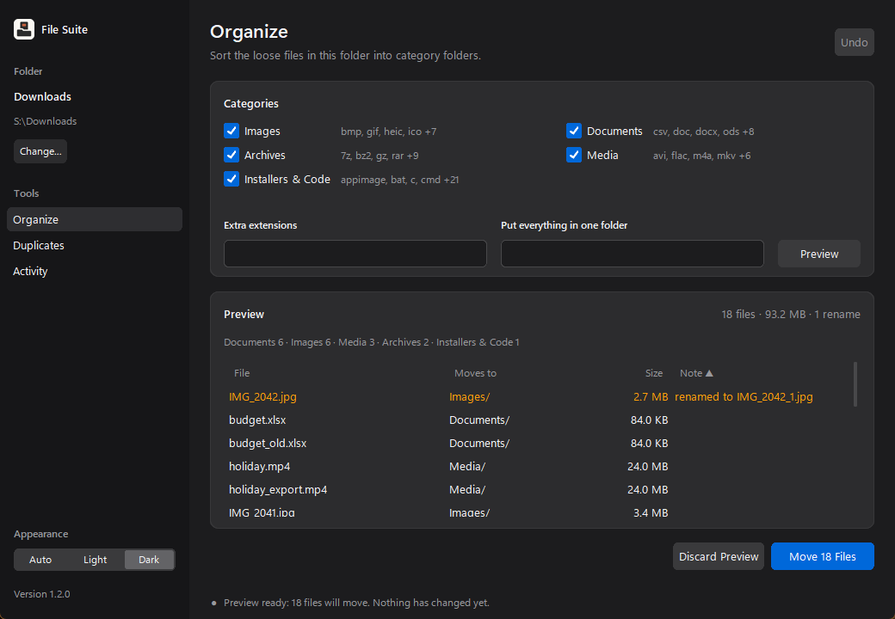
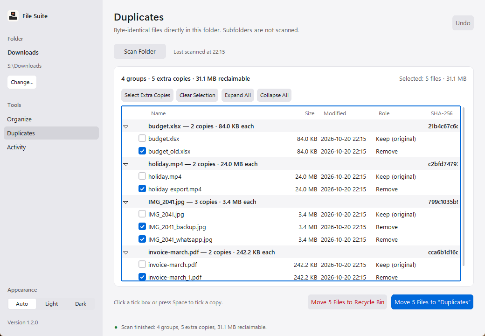
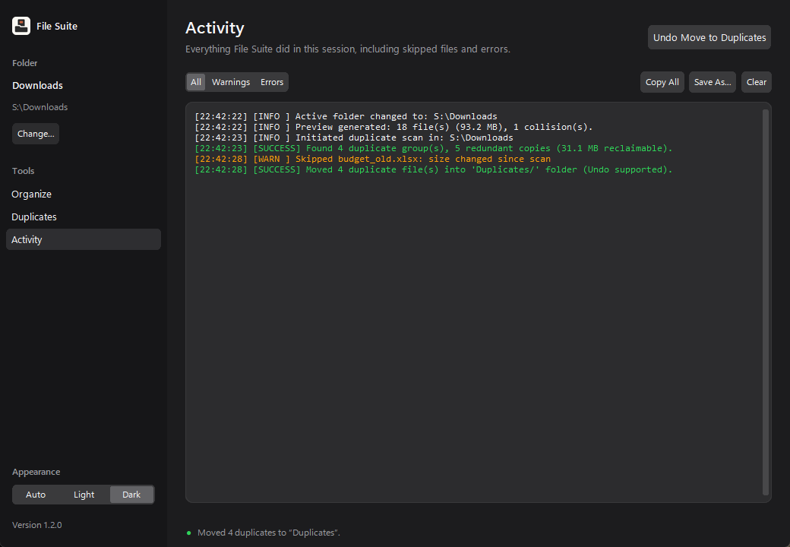
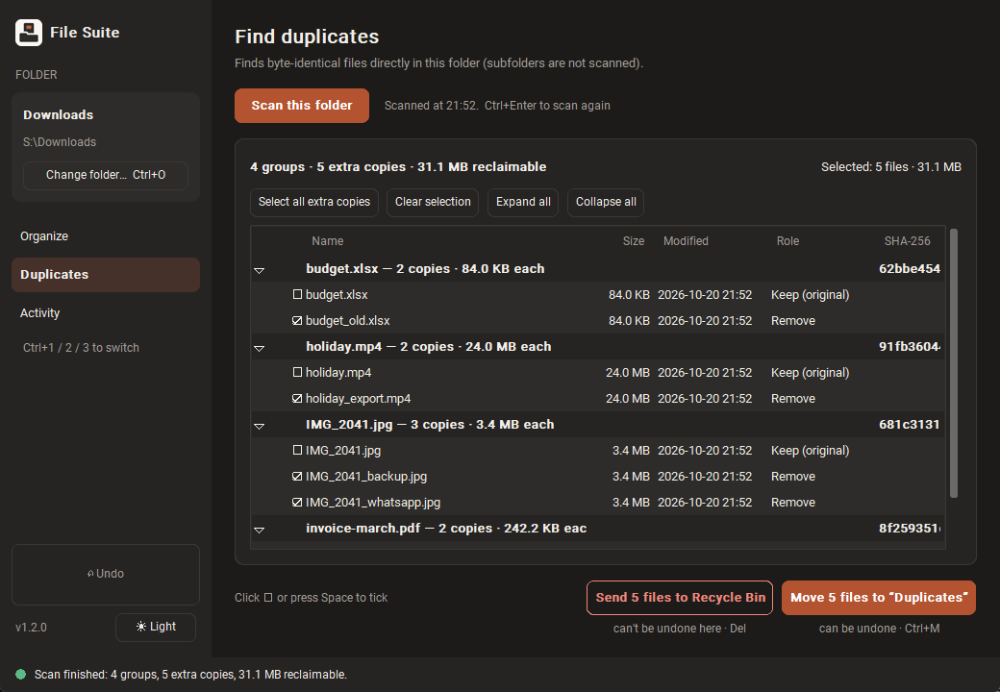
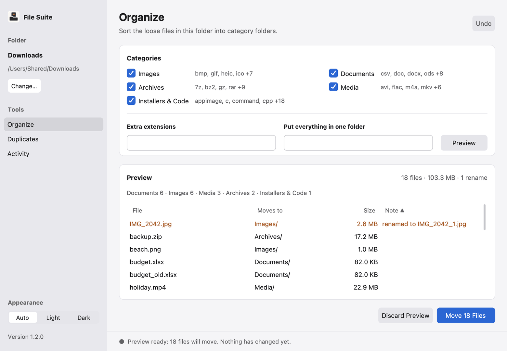
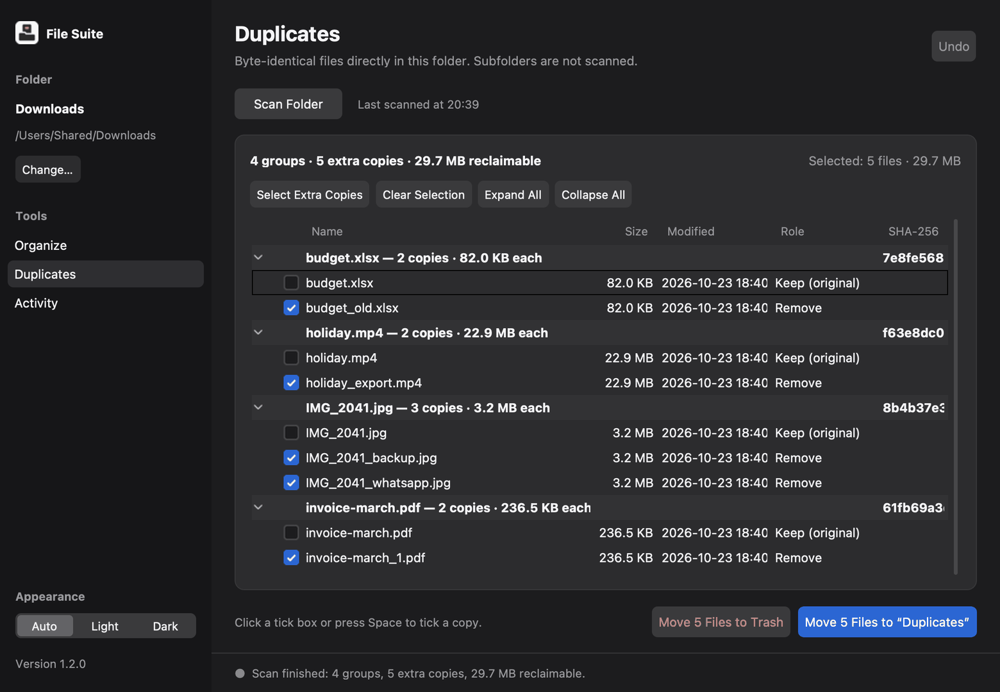
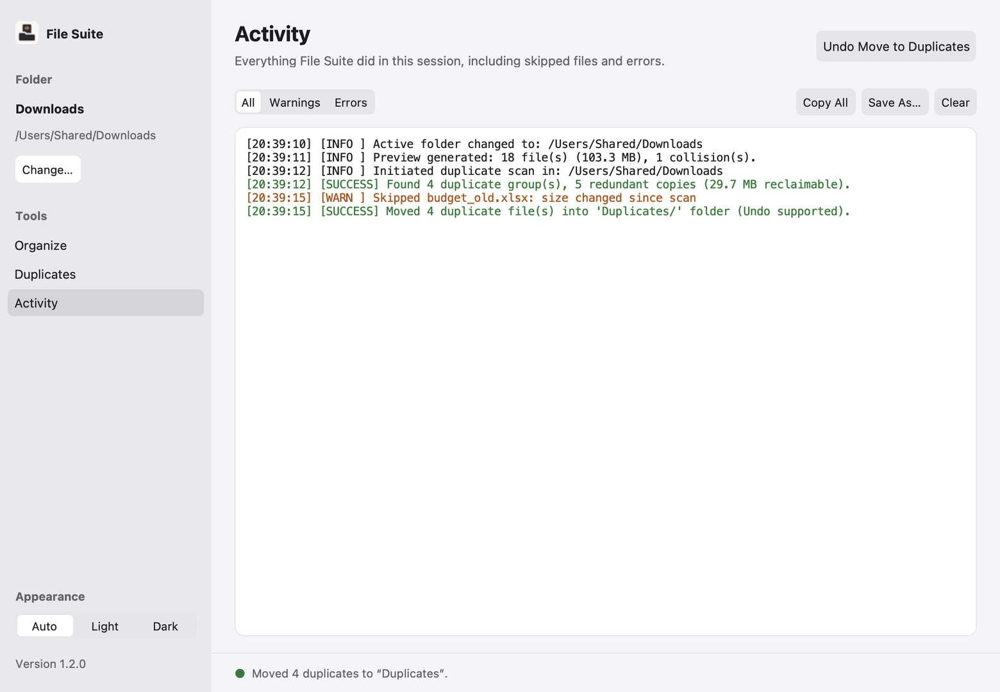

# File Suite


[](https://github.com/teppe21/File-Suite/actions/workflows/tests.yml)
[](https://github.com/teppe21/File-Suite/actions/workflows/windows.yml)
[](https://github.com/teppe21/File-Suite/actions/workflows/macos.yml)

Folders like Downloads fill up with loose files: photos, PDFs, installers, archives, and the same file saved two or three times. File Suite is a small desktop app that tidies one folder at a time. It sorts the loose files into category subfolders and finds byte-identical duplicates (compared by SHA-256), so you can remove the extra copies.

It is meant to be a careful helper, not a file manager or a backup tool. Every change is shown as a preview first, nothing happens until you confirm, existing files are never overwritten, and the last operation can be undone. It works only on files directly inside the chosen folder; subfolders, hidden files and symlinks are skipped.

<p align="center">
  
  <br/><br/>
  
  <br/><br/>
  
  <br/><br/>
  
</p>

On macOS:

<p align="center">
  
  <br/><br/>
  
  <br/><br/>
  
</p>

## What it does

- **Organize Files**: previews which files move into which category folder, with file counts, total size and any renames, then moves them on confirmation.
- **Duplicate Finder**: groups byte-identical files, lets you select the copies to remove (one original per group stays unselected by default), and moves them into a `Duplicates/` folder or to the system trash.
- **Activity Log**: shows a timestamped record of every operation, skip and error.

### Safety at a glance

- Every operation is previewed and needs confirmation; undo restores the last organize or duplicate move for the current session.
- Files are never overwritten; name collisions get a suffix such as `file_1.pdf`.
- Symlinks are skipped, and destination paths are checked again right before each move.
- At least one copy of each duplicate group is always kept.
- Files that changed since the duplicate scan are skipped.

Details: [docs/SAFETY.md](docs/SAFETY.md).

## Install and run

**Requirements**: Python 3.10 to 3.13 with Tk (on Linux, the `python3-tk` package). On Linux, `zenity` or `kdialog` is used for the folder picker if installed. Windows needs Windows 10 22H2 or newer, x64. macOS needs macOS 15 or newer on Apple silicon or Intel, and Python with Tk 8.6 from the python.org installer or from Homebrew (`python-tk@3.x`).

### Run from source

Linux:

```bash
git clone https://github.com/teppe21/File-Suite.git
cd File-Suite
python3 -m venv .venv
source .venv/bin/activate
pip install -r requirements.txt
python3 main.py
```

Windows (PowerShell):

```powershell
git clone https://github.com/teppe21/File-Suite.git
cd File-Suite
python -m venv .venv
.venv\Scripts\Activate.ps1
pip install -r requirements.txt
python main.py
```

macOS (Terminal):

```bash
git clone https://github.com/teppe21/File-Suite.git
cd File-Suite
python3 -m venv .venv
source .venv/bin/activate
pip install -r requirements.txt
python3 main.py
```

### Standalone build

Linux: `./build.sh` creates the single-file executable `dist/FileSuite`. `./install.sh` then copies it to `~/.local/bin` and adds a desktop launcher (category Utility/System); with `~/.local/bin` on your `PATH` it also starts with `FileSuite`.

```bash
./build.sh
./install.sh
```

Windows: `packaging\windows\build.ps1` creates `dist\FileSuite-windows-x64-v<version>.zip` and a `.sha256` file.

macOS: `packaging/macos/build.sh` creates `dist/FileSuite-macos-<arch>-v<version>.dmg` (`arm64` or `x86_64`, the architecture of the Mac that builds it) and a `.sha256` file. Install by dragging File Suite to Applications.

## Platform notes

Linux (X11 and Wayland) is the primary platform. Windows support is experimental and has been tested mainly through CI. Main Windows caveats:

- The executable is not code-signed, so SmartScreen may warn when you start it.
- On USB sticks and network shares, deleted duplicates may be deleted permanently instead of going to the Recycle Bin; the app warns before this.
- OneDrive online-only files are skipped.
- The native folder pickers are not used; the standard Tkinter dialog is shown.

Full list: [docs/SAFETY.md](docs/SAFETY.md#windows-specific-limitations).

macOS support is experimental as well, and AI assistance was used for the macOS port. It is tested through CI on macOS 15 and 26, and several things have not been tried on a real Mac yet. Main macOS caveats:

- The app is not notarized, so macOS blocks the first launch: click **Done**, then choose **Open Anyway** under System Settings › Privacy & Security. Steps: [docs/SAFETY.md](docs/SAFETY.md#opening-the-macos-app-for-the-first-time).
- macOS asks for permission the first time File Suite reads Downloads, Desktop, Documents, an external drive or a network volume.
- iCloud Drive files that are only in the cloud are skipped.
- The Intel (`x86_64`) DMG is built on CI and starts there, but has not been tried on an Intel Mac.

Full list: [docs/SAFETY.md](docs/SAFETY.md#macos-specific-limitations).

## Development

File Suite is developed with AI assistance. The author reviews every change before it is merged, and CI runs the unit tests, Ruff, Bandit and pip-audit on every pull request.
See [docs/DEVELOPMENT.md](docs/DEVELOPMENT.md) for architecture, tests and releases, and [CHANGELOG.md](CHANGELOG.md) for the release history.

## License

MIT. See [LICENSE](LICENSE).
