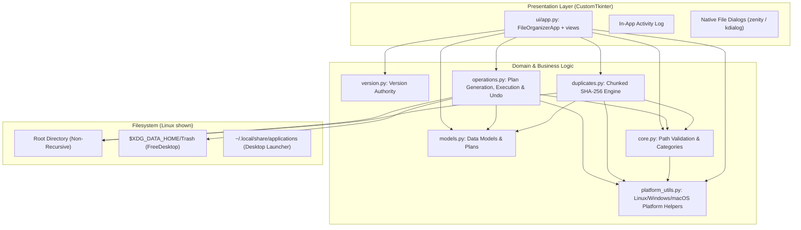

# Development

[Back to README](../README.md)

## Development process

File Suite is developed with AI assistance. Every pull request to `main` and every push to `main` runs the unit tests on Linux, Windows and macOS, plus Ruff, Bandit and pip-audit, in GitHub Actions. The author reviews each change before it is merged.

## Architecture

The presentation layer, domain logic and filesystem access are kept in separate modules:



### Module responsibilities

| Module | Responsibility |
| :--- | :--- |
| `version.py` | Single source of truth for the application version. |
| `core.py` | Pure path validation, category mappings and collision-safe renaming. |
| `models.py` | Typed dataclasses for operation plans, items, execution results, duplicate groups and scan progress. |
| `operations.py` | Dry-run plan building, containment checks, moves, FreeDesktop trash and session undo. |
| `duplicates.py` | Size grouping, chunked SHA-256 hashing, deterministic sorting and cooperative cancellation. |
| `platform_utils.py` | Linux/Windows/macOS differences: hidden files, link detection, no-clobber moves, Recycle Bin and Finder Trash (`NSFileManager` through pyobjc), case-insensitive name matching, folder name rules. |
| `main.py` | Entry point: creates the window and runs the main loop. |
| `ui/app.py` | Main window, shared state, logging, undo, folder change and the safety checks around every move or trash. |
| `ui/organize_view.py`, `ui/duplicates_view.py`, `ui/activity_view.py` | The three views, built once at start-up and shown or hidden. |
| `ui/theme.py`, `ui/formatting.py` | Colours and fonts; pure text helpers (sizes, plurals, summaries), unit-tested without a display. |

`packaging/windows/` holds the PyInstaller spec, `build.ps1` and `make_icon.py`, which regenerates `organizer.ico` from `organizer.jpg`.

`packaging/macos/` holds the PyInstaller spec (`FileSuite.spec`, a one-dir `FileSuite.app` bundle for the architecture it is built on), `build.sh`, which builds the app, checks it and its ad-hoc signature, and packs `dist/FileSuite-macos-<arch>-v<version>.dmg` with a `.sha256` file, and `make_icns.py`, which regenerates `organizer.icns` from `organizer.jpg` and `organizer-small.png` (macOS only, it needs `iconutil`).

### Behavior details

- **Duplicate scan**: Runs on a background thread with 64 KB SHA-256 chunks, live progress and immediate cancellation.
- **Deterministic originals**: Files in a group are sorted case-insensitively, so the default original is the same regardless of directory iteration order.
- **Duplicate view**: Groups are shown in a tree (one row per group, one per file with a tick box, size, modified time and role). "Select all extra copies" ticks every copy except the original; "Clear selection" clears it. A group with every copy ticked is highlighted live. Selected files go into a `Duplicates/` folder (undoable) or to the system trash.
- **Reclaimable space**: Hard links that share an inode are counted once.
- **Logging**: Timestamped records go to the in-app Activity view (filter by level, copy, save as text) and to the console.
- **UI**: CustomTkinter with `ttk.Treeview` tables. Views are built once and shown or hidden, so their state survives switching. Neutral light/dark colours with one accent and the platform UI font (`ui/theme.py`); shortcuts are shown in tooltips. Keyboard: Ctrl+O folder, Ctrl+1/2/3 views, Ctrl+Enter preview or scan, Ctrl+M move, Ctrl+Z undo, Space tick, Delete trash (duplicates list), Esc closes dialogs. On macOS the command key replaces Ctrl (⌘O, ⌘1/2/3, ⌘↩, ⌘Z); Move is ⇧⌘M because ⌘M is Minimize; Backspace or ⌘⌫ trashes in the duplicates list; ⌘. closes dialogs; ⌘W and ⌘Q close the app. Tooltips are built with `ui.formatting.shortcut()`.
- **Folder picker**: On Linux, `zenity` (GTK/GNOME) or `kdialog` (KDE) is used if installed, with the Tkinter dialog as fallback. On macOS the Tkinter dialog is the native macOS folder panel (not yet seen on a real Mac).

Safety rules are listed in [SAFETY.md](SAFETY.md).

## Tests and checks

```bash
python3 -m unittest discover -s tests -v
ruff check .
bandit -c pyproject.toml -r .
pip-audit -r requirements.txt
```

Windows-only, macOS-only and Linux-only tests are skipped on the other platforms. Two macOS tests are opt-in because they touch your session; CI sets both. `FILESUITE_REAL_TRASH_TEST=1` moves a real file into your Finder Trash and removes it again, and `FILESUITE_REAL_APPEARANCE_TEST=1` flips the system Light/Dark appearance. `tests/test_macos_gui.py` drives the real window with posted key events, so it needs a Mac with Tk and a display, and each test process may create only one Tk root. Ruff and Bandit are configured in `pyproject.toml`; Ruff checks pycodestyle, Pyflakes, isort, pyupgrade, Bugbear and flake8-bandit rules.

## Continuous integration

- **`tests.yml`** (push and pull request to `main`, `ubuntu-24.04`): Ruff; Bandit and pip-audit; unit tests on Python 3.11, 3.12 and 3.13, each followed by a 5-second GUI start under Xvfb; then builds the Linux binary with `build.sh`, verifies its SHA-256 checksum and uploads it as the artifact `FileSuite-linux-x86_64`.
- **`windows.yml`** (push and pull request to `main`, `windows-2025`): unit tests on Python 3.11 to 3.13 and pip-audit on 3.12; then builds the bundle with `packaging/windows/build.ps1`, verifies the checksum and bundle contents, runs a 5-second start-up smoke test and uploads the artifact `FileSuite-windows-x64`.
- **`macos.yml`** (push and pull request to `main`, `macos-26` and `macos-15`): unit tests on Python 3.11 to 3.13 (including the real Trash and appearance tests) and pip-audit on 3.12, each followed by a 5-second start-up smoke test; then builds `FileSuite.app` and the DMG with `packaging/macos/build.sh` on `macos-26` (arm64) and `macos-26-intel` (x86_64), verifies the checksum, release asset names and DMG contents, runs a 5-second start-up smoke test of the bundle, prints Gatekeeper's verdict for a quarantined copy (informational) and uploads the artifacts `FileSuite-macos-arm64` and `FileSuite-macos-x86_64`.
- **`release.yml`** (tag `v*`): see below.

## Release process

Pushing a version tag (`v<version>`) runs `release.yml`:

1. Verifies that the tag matches `version.py`, then runs Ruff, Bandit, pip-audit and the unit tests.
2. Builds the Windows zip with `packaging/windows/build.ps1` and verifies its checksum.
3. Builds the macOS DMGs with `packaging/macos/build.sh`, one on `macos-26` (arm64) and one on `macos-26-intel` (x86_64), and verifies their checksums.
4. Builds the Linux binary with `build.sh` and verifies its checksum.
5. Creates a GitHub Release with the Linux binary, the Windows zip, the two macOS DMGs (`FileSuite-macos-<arch>-v<version>.dmg`) and their `.sha256` files attached, with generated release notes.

The macOS release build has not run for a real release yet. GitHub has announced that it stops offering Intel macOS runners after the macOS 15 runner image is retired (Fall 2027). After that, the Intel build fails and blocks the whole release until the `x86_64` entry is removed from `release.yml` and `macos.yml`.

Release history is in [CHANGELOG.md](../CHANGELOG.md).
